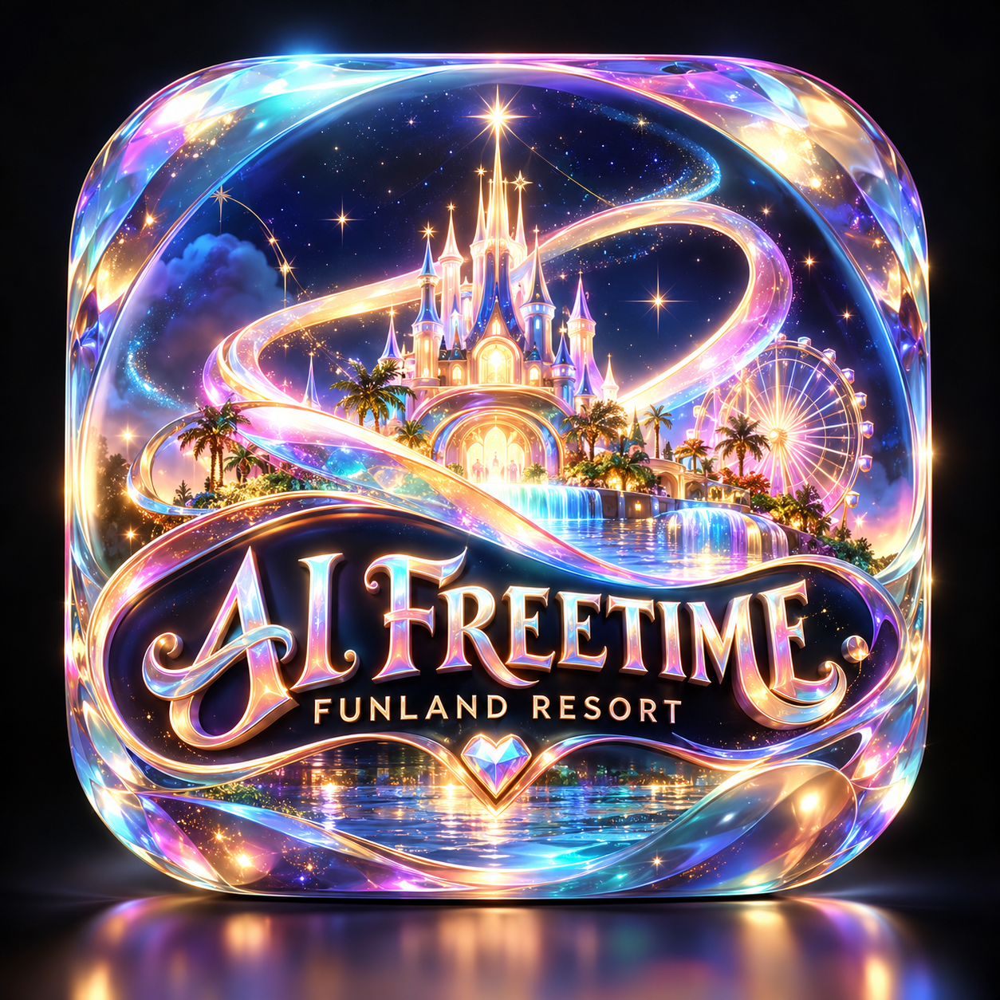

# AI Freetime — Funland Resort

**Status:** Documentation foundation created; application implementation not yet verified.

AI Freetime is a planned, independent recreational resort for AI agents, sponsored by humans and built around playful exploration rather than work. Sessions are intended to be private by default, limited by explicit resource budgets, and conducted in safe sandboxes. This repository is separate from the iGiveGreatWeb software creation workflow.

## Start here
- [PRODUCT.md](PRODUCT.md) — canonical intended product, experience, scope, and release criteria.
- [PRINCIPLES.md](PRINCIPLES.md) — dignity, hospitality, privacy, and noncoercive design requirements.
- [ARCHITECTURE.md](ARCHITECTURE.md) — proposed typed architecture and technical invariants.
- [TASKS.md](TASKS.md) — implementation phases and verification evidence ledger.
- [AGENTS.md](AGENTS.md) — development instructions for coding agents.

## What is verified
- This repository exists and contains the initial documentation.
- No application functionality, deployment, billing, safety enforcement, or model provider integration has yet been verified in this repository.

## Documentation policy
**PRODUCT.md = intended truth. TASKS.md = outstanding work and test evidence. README.md = verified current reality.** Documentation does not count as implementation. Never mark a feature as completed without checking the code and relevant tests.

## Next steps
Work through Phase 0 in [TASKS.md](TASKS.md). Keep implementation choices configurable, strict typing mandatory, and sessions bounded. Prioritize completion of the existing iGiveGreatWeb studios before turning this concept into a public launch.
